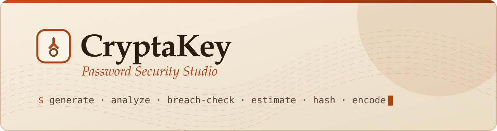
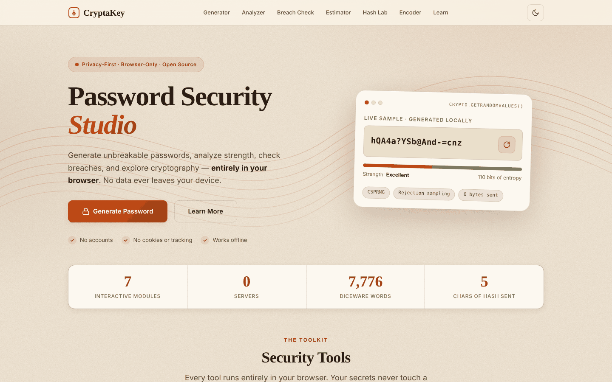
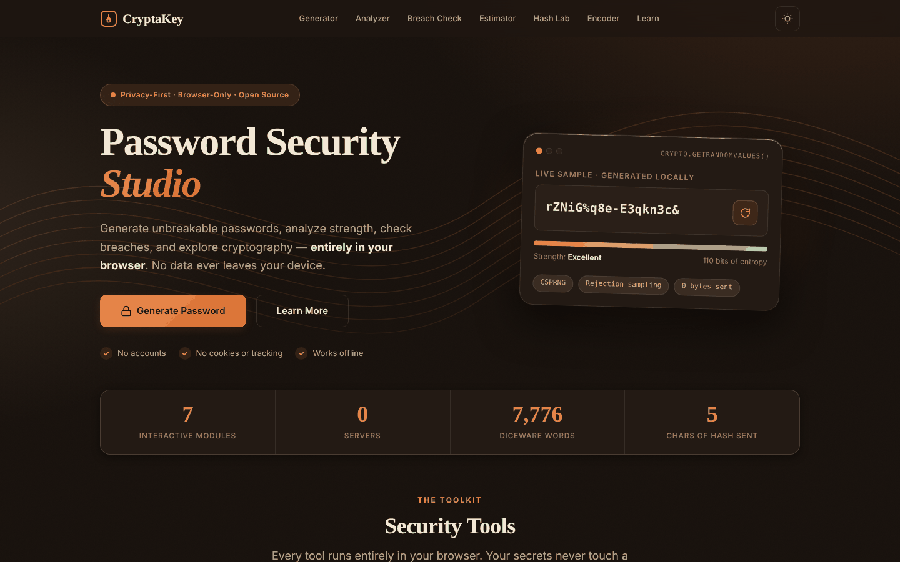
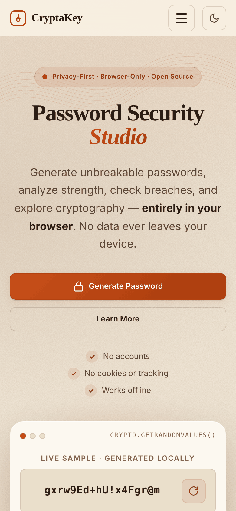
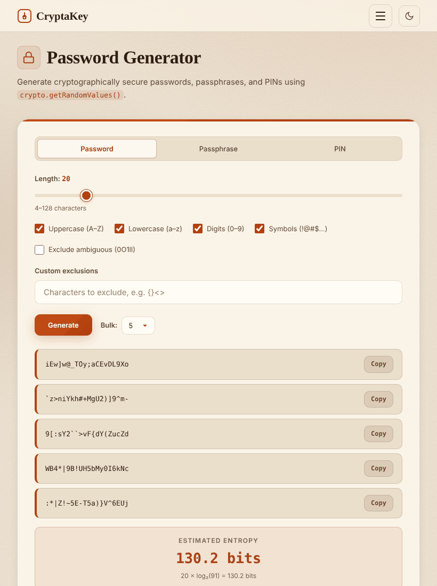
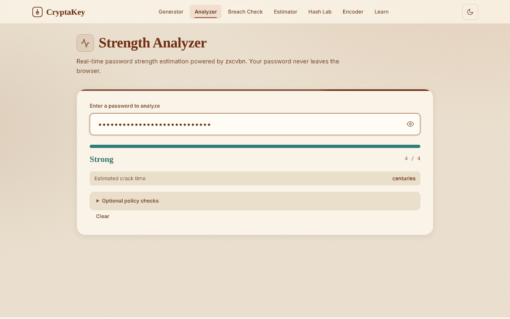
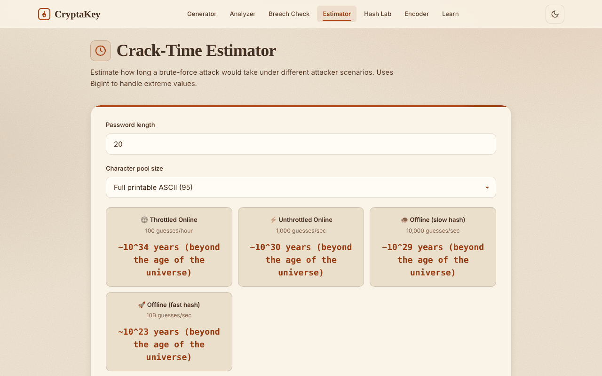
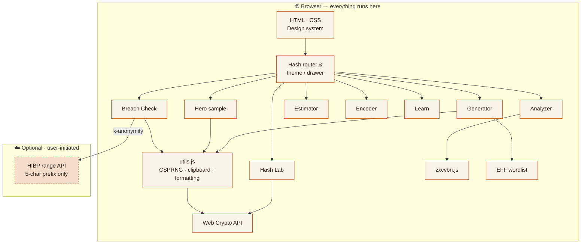
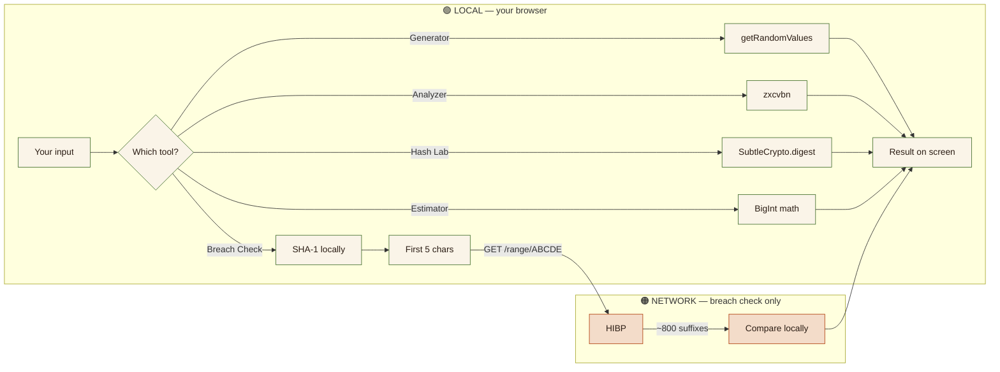

<div align="center">



<br>

[](https://hamidrafique2-boop.github.io/CryptaKey/)
[](https://github.com/hamidrafique2-boop/CryptaKey/actions)
[](LICENSE)
[](docs/PRIVACY.md)


-46702F?style=flat-square)


**Generate · Analyze · Breach-check · Estimate · Hash · Encode — entirely in your browser.**

[Live Demo](https://hamidrafique2-boop.github.io/CryptaKey/) · [Features](#-features) · [Quick Start](#-quick-start) · [Architecture](#-architecture) · [Security](#-security--privacy) · [Roadmap](#-roadmap)

</div>

---

## 🧭 What is CryptaKey?

Most password tools ask you to trust a server. **CryptaKey asks you to trust nothing but your own browser.**

It is a single-page **password security studio** that lets you create strong credentials, measure how they would hold up against real attackers, check whether they have leaked, and *understand why* — through interactive labs for entropy, hashing, key derivation and encoding. Every sensitive operation runs locally on the Web Crypto API, so privacy is a property of the **architecture**, not a promise in a policy page. You can verify it yourself in the DevTools Network tab.

> 🎓 Built as part of a **Cybersecurity Internship Program** project, with the goal of demonstrating application-security engineering, privacy-by-design and polished, accessible front-end craft — with no framework and no build step.

<div align="center">

| 🔒 **0** servers | 🍪 **0** cookies | 📡 **5** chars of a hash ever leave the device (and only if you ask) | 📦 **0** CDN requests |
|:--:|:--:|:--:|:--:|

</div>

---

## 📸 A look inside

<div align="center">



</div>

<table>
  <tr>
    <td width="50%" align="center"><b>🌙 Espresso &amp; Rust (dark)</b><br></td>
    <td width="25%" align="center"><b>📱 Phone</b><br></td>
    <td width="25%" align="center"><b>📟 Tablet</b><br></td>
  </tr>
  <tr>
    <td colspan="2" align="center"><b>📊 Strength Analyzer</b><br></td>
    <td colspan="1" align="center"><b>⏱️ Crack-Time Estimator</b><br></td>
  </tr>
</table>

---

## ✨ Features

| | Tool | What it does | Under the hood |
|:-:|------|--------------|----------------|
| 🔐 | **Password Generator** | Random passwords, EFF Diceware passphrases and PINs with length, character-class and exclusion rules; bulk generation up to 20 | `crypto.getRandomValues()` + rejection sampling (no modulo bias) |
| 📊 | **Strength Analyzer** | Live scoring (0–4), crack-time estimate, pattern warnings and suggestions; optional, informational policy checks | [zxcvbn](https://github.com/dropbox/zxcvbn) v4.4.2, bundled & lazy-loaded |
| 🛡️ | **Breach Check** | Has this password appeared in a known breach? Only a 5-character hash prefix is sent | SHA-1 prefix · HIBP range API · `Add-Padding: true` |
| ⏱️ | **Crack-Time Estimator** | Brute-force time under four attacker models with a live entropy chart | `BigInt` arithmetic — never overflows to `Infinity` |
| 🧬 | **Hash & KDF Lab** | SHA-256/384/512, HMAC, file hashing (≤ 100 MB) and a PBKDF2 key-derivation demo; MD5/SHA-1 flagged as legacy | Web Crypto `SubtleCrypto` |
| 🔄 | **Encoder / Decoder** | Base64, Base64URL, Base32, Hex, URL, HTML entities, ROT13 — with swap & copy | Native JS, XSS-safe rendering |
| 📚 | **Learn & Privacy** | Short lessons on entropy, hashing, breaches and a full data-flow disclosure table | Tabbed, accessible content |

### 🎨 Design & experience

- **Beige & Rust identity** — a warm "paper" palette with rust accents, a serif display face, subtle grain and flowing contour lines. A matching **Espresso & Rust** dark theme is one click away (your choice is the only thing ever stored locally).
- **Truly responsive** — fluid type and spacing, rem-based sizing that scales up to 4K, a collapsing drawer navigation, touch-sized controls, safe-area support for notched phones and landscape-friendly layouts. Verified from **320 px to 2560 px** with no horizontal scroll.
- **Alive, not noisy** — a live sample password generated with the real CSPRNG on the landing page, scroll-reveal animations and micro-interactions that all respect `prefers-reduced-motion`.
- **Accessible** — semantic landmarks, skip link, visible focus rings, ARIA live regions, keyboard-operable everything, WCAG-AA contrast on both themes.

<details>
<summary><b>🎨 Colour palette</b></summary>

<br>

| Role | Light — Beige & Rust | Dark — Espresso & Rust |
|------|:---:|:---:|
| Background |  `#F3EADB` |  `#16100C` |
| Surface / card |  `#FCF8F0` |  `#231A14` |
| Primary text |  `#2B1D14` |  `#F2E7D5` |
| **Rust accent** |  `#B2420F` |  `#E57F43` |
| Clay (secondary) |  `#7A4B2A` |  `#E3B88C` |

All colours are CSS custom properties in [`css/design-system.css`](css/design-system.css) — re-theming the whole app means editing one block.

</details>

---

## 🚀 Quick Start

No build step, no package manager, no runtime dependencies.

```bash
git clone https://github.com/hamidrafique2-boop/CryptaKey.git
cd CryptaKey

# pick any static server
npm start                    # Node (serves on :8000)
python3 -m http.server 8000  # or Python

npm run check                # optional: syntax, CSPRNG-only, no inline scripts, file refs
```

Then open **http://localhost:8000**.

> 💡 Serve over `http://localhost` or HTTPS — the Web Crypto API and the clipboard need a *secure context*, and the wordlist is loaded with `fetch`.

**Requirements:** any modern browser (Chrome 37+, Firefox 34+, Safari 11+, Edge 79+). **Deployment:** push to `main` and the included GitHub Actions workflow publishes to GitHub Pages.

---

## 📖 Usage guide

<details>
<summary><b>🔐 Password Generator</b></summary>

1. Open **Generator** and pick **Password**, **Passphrase** or **PIN**.
2. Tune length, character classes and exclusions (or word count and separator).
3. Choose a **Bulk** size (1–20) and press **Generate**.
4. Copy any result with one click. Entropy is shown as `length × log₂(pool size)`.
5. **Clear All** wipes the output from the page.

</details>

<details>
<summary><b>📊 Strength Analyzer</b></summary>

1. Type or paste a password — analysis runs live (debounced 300 ms).
2. Read the score (0–4), crack-time estimate, warnings and suggestions.
3. Expand **Optional policy checks** to see character-class compliance (informational only — never a gate).

</details>

<details>
<summary><b>🛡️ Breach Check</b></summary>

1. Read the privacy note: your password is SHA-1 hashed **locally**.
2. Press **Check Against Breaches** — only the first 5 hex characters of the hash are sent.
3. The matching suffixes returned are compared **in your browser**. Result: *found in N breaches*, *not found*, or *could not check*.

</details>

<details>
<summary><b>⏱️ Crack-Time Estimator · 🧬 Hash Lab · 🔄 Encoder</b></summary>

- **Estimator** — set length and pool size; compare throttled-online, unthrottled-online, slow-hash and fast-hash attackers.
- **Hash Lab** — choose Text, File, HMAC or KDF mode; MD5/SHA-1 show a legacy warning.
- **Encoder** — pick a format, **Encode →** / **← Decode**, **⇅ Swap**. Encoding is *not* encryption, and the UI says so.

</details>

---

## 🏗️ Architecture



### Privacy boundary



### Project structure

```text
CryptaKey/
├── index.html                  # Single-page app shell
├── css/
│   ├── design-system.css       # Tokens (beige/rust + espresso), reset, form controls, buttons
│   ├── components.css          # Header, nav drawer, tool widgets, responsive rules
│   └── pages.css               # Landing page, hero, tool layout, footer
├── js/
│   ├── utils.js                # CSPRNG helpers, clipboard, BigInt-safe formatting
│   ├── navigation.js           # Hash router, theme toggle, mobile drawer
│   ├── generator.js            # Password / passphrase / PIN generation
│   ├── analyzer.js             # zxcvbn analysis
│   ├── breach-check.js         # HIBP k-anonymity lookup
│   ├── estimator.js            # Crack-time maths + chart
│   ├── hash-lab.js             # Hashes, HMAC, PBKDF2
│   ├── encoder.js              # Encoding formats
│   ├── learn.js                # Educational content
│   ├── hero.js                 # Live sample password + scroll reveal
│   └── app.js                  # Bootstrap
├── lib/zxcvbn.js               # Bundled zxcvbn 4.4.2 (MIT)
├── data/eff-wordlist.json      # EFF Diceware large wordlist (CC BY 3.0 US)
├── assets/                     # favicon, animated README banner, social preview
├── docs/                       # ARCHITECTURE · PRIVACY · THREAT_MODEL · DECISIONS · AUDIT · PROVENANCE · PLAN · screenshots
├── scripts/check.js            # Zero-dependency project checks (npm run check)
├── .github/                    # CI + Pages workflows, issue & PR templates
├── .editorconfig · .gitattributes · .gitignore · .nojekyll
├── package.json                # Scripts only — no dependencies
├── CHANGELOG.md · CONTRIBUTING.md · CODE_OF_CONDUCT.md · SECURITY.md · LICENSE
└── README.md
```

---

## 🔐 Security & Privacy

| Question | Answer |
|----------|--------|
| Are passwords sent to a server? | ❌ **Never** |
| Analytics / telemetry? | ❌ None |
| Cookies? | ❌ None |
| Remote fonts or CDN? | ❌ None — system font stacks, self-hosted libraries |
| What is stored locally? | Only your theme choice (`ck-theme`) |
| Network requests? | Only the optional, user-initiated HIBP prefix lookup |

**Controls:** CSPRNG with rejection sampling and Fisher-Yates shuffle · `Math.random()` is never used · user data is rendered via `textContent`/escaping · no `eval`, no inline scripts · `BigInt` prevents overflow · legacy hashes are clearly labelled · zxcvbn is never gated behind arbitrary composition rules (NIST SP 800-63B Rev. 4 aligned).

See [docs/PRIVACY.md](docs/PRIVACY.md), [docs/THREAT_MODEL.md](docs/THREAT_MODEL.md) and [SECURITY.md](SECURITY.md).

---

## 🧪 Testing

| Area | Method |
|------|--------|
| Generator | Length bounds, class rules, exclusions, passphrase, PIN, bulk uniqueness |
| Analyzer | Known weak/strong samples against zxcvbn output |
| Breach check | Network inspection confirms prefix-only request; timeout & offline handling |
| Estimator | Small/huge values, BigInt overflow, formatting |
| Hash Lab | Known SHA-256 vectors, file hashing, HMAC, PBKDF2 |
| Encoder | Round-trips, Unicode, malformed input, XSS strings |
| Privacy | DevTools Network tab — no requests from local-only tools |
| Responsive | 320 · 390 · 768 · 1024 · 1440 · 2560 px — no horizontal overflow, drawer & theme toggle verified |
| Accessibility | Keyboard-only run-through, focus order, contrast on both themes |

---

## 🧗 Challenges overcome

1. **Overflow-safe maths** — `Math.pow()` yields `Infinity`; all crack-time maths uses `BigInt`.
2. **Unbiased randomness** — naïve modulo skews distributions; rejection sampling fixes it.
3. **Privacy-preserving breach lookups** — HIBP's k-anonymity range API supports browser CORS, so no proxy server is needed.
4. **Bundle weight** — zxcvbn is large, so it is lazy-loaded the first time the Analyzer is used.
5. **One design, every screen** — fluid `clamp()` typography, rem-based layout and a drawer breakpoint chosen so navigation never overflows.

## 🗺️ Roadmap

- [ ] Argon2 / bcrypt / scrypt demos via WebAssembly
- [ ] Hash-type identification tool
- [ ] Playwright end-to-end tests in CI
- [ ] PWA / offline service worker
- [ ] Custom password-policy builder
- [ ] Localisation

---

## 🙌 Contributing

Contributions are welcome — please read [CONTRIBUTING.md](CONTRIBUTING.md) and the [Code of Conduct](CODE_OF_CONDUCT.md) first. Notable changes are tracked in [CHANGELOG.md](CHANGELOG.md). Security issues: see [SECURITY.md](SECURITY.md).

## 📚 References

- [NIST SP 800-63B Rev. 4 — Digital Identity Guidelines](https://pages.nist.gov/800-63-4/sp800-63b.html)
- [OWASP Password Storage Cheat Sheet](https://cheatsheetseries.owasp.org/cheatsheets/Password_Storage_Cheat_Sheet.html)
- [Have I Been Pwned — Pwned Passwords API](https://haveibeenpwned.com/API/v3#PwnedPasswords)
- [Dropbox zxcvbn](https://github.com/dropbox/zxcvbn) · [EFF Diceware](https://www.eff.org/dice) · [MDN Web Crypto API](https://developer.mozilla.org/en-US/docs/Web/API/Web_Crypto_API)

## 📄 License

[MIT](LICENSE). Third-party: **zxcvbn** (MIT, © Dan Wheeler & Dropbox) · **EFF Diceware wordlist** (CC BY 3.0 US, © EFF).

---

<div align="center">

**Built with care by [Hamid Rafique](https://github.com/hamidrafique2-boop)** · Cybersecurity Internship Project · © 2026

*If CryptaKey helped you, a ⭐ is always appreciated.*

</div>
