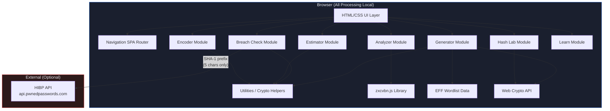
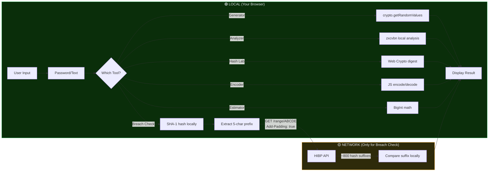

<div align="center">

# 🔐 CryptaKey

### Password Security Studio

*Generate, analyze, and secure passwords — entirely in your browser.*

[](LICENSE)
[](https://hamidrafique2-boop.github.io/CryptaKey/)
[](https://developer.mozilla.org/en-US/docs/Web/JavaScript)
[](https://developer.mozilla.org/en-US/docs/Web/API/Web_Crypto_API)
[](docs/PRIVACY.md)

[Live Demo](https://hamidrafique2-boop.github.io/CryptaKey/) · [Documentation](docs/) · [Report Issue](https://github.com/hamidrafique2-boop/CryptaKey/issues)

</div>

---

## 📋 Project Overview

**CryptaKey** is a privacy-first, browser-based password security studio designed to help users generate strong passwords, analyze their strength, check for data breaches, estimate crack times, explore cryptographic hashing, and learn about password security — all without sending any sensitive data to a server.

### Objectives

- **Privacy by Architecture**: All password operations run locally using the Web Crypto API — no server receives your passwords
- **Security Education**: Teach users about entropy, hashing, KDFs, breaches, and best practices through interactive tools
- **Professional Quality**: Production-grade code, responsive design, full accessibility, and comprehensive documentation
- **Portfolio Demonstration**: Showcase application security engineering, modern frontend development, and security-conscious design

---

## ✨ Features & Technologies

### Core Security Tools

| Tool | Description | Technology |
|------|-------------|------------|
| 🔐 **Password Generator** | Random passwords, passphrases (EFF Diceware), and PINs with configurable rules | `crypto.getRandomValues()` with rejection sampling |
| 📊 **Strength Analyzer** | Real-time scoring with pattern detection, suggestions, and optional policy checks | [zxcvbn](https://github.com/dropbox/zxcvbn) (bundled, MIT) |
| 🛡️ **Breach Check** | k-anonymity lookup against Have I Been Pwned breach database | SHA-1 prefix (5 chars) via HIBP API |
| ⏱️ **Crack-Time Estimator** | Brute-force time under 4 attacker scenarios with interactive visualization | BigInt arithmetic (overflow-safe) |
| 🧬 **Hash & KDF Lab** | SHA-256/384/512, HMAC, MD5/SHA-1 (legacy demos), PBKDF2 key derivation | Web Crypto API |
| 🔄 **Encoder / Decoder** | Base64, Base64URL, Base32, Hex, URL encoding, HTML entities, ROT13 | Native JavaScript APIs |
| 📚 **Learn & Privacy** | Educational content on passwords, entropy, hashing, breaches, and complete data flow disclosure | Interactive tabbed content |

### Technical Stack

| Layer | Technology |
|-------|------------|
| **Structure** | Semantic HTML5 with ARIA landmarks |
| **Styling** | Vanilla CSS with custom properties (design system), dark/light themes |
| **Logic** | Vanilla JavaScript (ES2020+), no framework dependencies |
| **Cryptography** | Web Crypto API (`crypto.getRandomValues()`, `SubtleCrypto`) |
| **Strength Analysis** | zxcvbn.js v4.4.2 (MIT, self-hosted) |
| **Wordlist** | EFF Diceware Large Wordlist (7,776 words, CC BY 3.0 US) |
| **Hosting** | GitHub Pages (static, HTTPS) |
| **CI/CD** | GitHub Actions |

---

## 🚀 Installation & Setup

### Quick Start (Local)

```bash
# Clone the repository
git clone https://github.com/hamidrafique2-boop/CryptaKey.git
cd CryptaKey

# No build step required — just open in a browser
# Option 1: Use any local server
npx serve .

# Option 2: Python
python -m http.server 8000

# Option 3: Open directly (some features require HTTPS/localhost)
# Open index.html in your browser
```

### Requirements

- Modern browser with Web Crypto API support (Chrome 37+, Firefox 34+, Safari 11+, Edge 79+)
- No Node.js, Python, or server-side runtime required
- No build step, transpilation, or bundler needed

---

## 📖 Usage Guide

### Password Generator
1. Navigate to **Generator** from the top menu
2. Select mode: **Password**, **Passphrase**, or **PIN**
3. Configure length, character classes, and exclusions
4. Click **Generate** — results appear with copy buttons
5. Use **Bulk** dropdown to generate up to 20 at once
6. Entropy is calculated and displayed: `length × log₂(pool_size)`

### Strength Analyzer
1. Navigate to **Analyzer**
2. Type or paste any password — analysis runs live (debounced 300ms)
3. View score (0–4), crack-time estimate, detected patterns, and suggestions
4. Expand **Optional policy checks** for character-class compliance (informational only)

### Breach Check
1. Navigate to **Breach Check**
2. Read the privacy disclosure explaining what data is sent
3. Enter a password and click **Check Against Breaches**
4. Only the first 5 characters of the SHA-1 hash are sent to HIBP
5. Results: "Found in N breaches" / "Not found" / "Could not check"

### Crack-Time Estimator
1. Navigate to **Estimator**
2. Set password length and character pool size
3. View estimated times across 4 scenarios (throttled online → offline fast hash)
4. Interactive visualization shows how length affects entropy

### Hash & KDF Lab
1. Navigate to **Hash Lab**
2. Choose mode: **Text Hash**, **File Hash**, **HMAC**, or **KDF Demo**
3. Select algorithm (SHA-256/384/512, or legacy MD5/SHA-1 with warnings)
4. View the computed hash with one-click copy

### Encoder / Decoder
1. Navigate to **Encoder**
2. Select format, enter text, click **Encode →** or **← Decode**
3. Use **⇅ Swap** to reverse input/output
4. Note: Encoding provides **no security** — clearly stated in the UI

---

## 🏗️ System Architecture

### Component Diagram



### Data Flow — Privacy Boundary



### File Structure

```
CryptaKey/
├── index.html              # Single-page application entry point
├── css/
│   ├── design-system.css   # CSS custom properties, reset, utilities
│   ├── components.css      # Reusable component styles
│   └── pages.css           # Page layouts, hero, footer
├── js/
│   ├── utils.js            # CSPRNG helpers, clipboard, formatting
│   ├── navigation.js       # SPA routing, theme, mobile menu
│   ├── generator.js        # Password/passphrase/PIN generator
│   ├── analyzer.js         # zxcvbn strength analysis
│   ├── breach-check.js     # HIBP k-anonymity breach lookup
│   ├── estimator.js        # BigInt crack-time calculator
│   ├── hash-lab.js         # Web Crypto hashing, HMAC, KDF
│   ├── encoder.js          # Base64/32/Hex/URL/HTML/ROT13
│   ├── learn.js            # Educational content renderer
│   └── app.js              # App initialization
├── lib/
│   └── zxcvbn.js           # Bundled zxcvbn v4.4.2 (MIT)
├── data/
│   └── eff-wordlist.json   # EFF Diceware large wordlist (CC BY 3.0)
├── assets/
│   └── favicon.svg         # SVG favicon
├── docs/
│   ├── AUDIT.md            # Previous implementation audit
│   ├── DECISIONS.md        # Architecture & design decisions
│   ├── PROVENANCE.md       # Attribution & licensing
│   ├── PLAN.md             # Implementation plan
│   ├── PRIVACY.md          # Privacy & data flow documentation
│   ├── ARCHITECTURE.md     # Technical architecture details
│   └── THREAT_MODEL.md     # Security threat model
├── .gitignore
├── LICENSE                 # MIT License
├── SECURITY.md             # Security policy
├── CONTRIBUTING.md         # Contribution guidelines
└── README.md               # This file
```

---

## 🧪 Testing & Results

### Test Categories

| Category | Scope | Method |
|----------|-------|--------|
| Generator | Length bounds, character rules, exclusions, passphrase, PIN, bulk | Manual + automated |
| Analyzer | Known weak/strong passwords, zxcvbn scoring, policy checks | Manual verification |
| Breach Check | HIBP API contract, prefix-only URL, timeout, offline handling | Manual + network inspection |
| Estimator | Small/large values, BigInt overflow, formatting | Manual verification |
| Hash Lab | Known test vectors (SHA-256), file hashing, HMAC, KDF | Manual + test vector comparison |
| Encoder | Round-trip all formats, Unicode, malformed input, XSS strings | Manual verification |
| Privacy | No network requests for local tools (DevTools Network tab) | Manual verification |
| Accessibility | Keyboard navigation, screen reader, contrast, mobile | Manual browser testing |

### Key Verifications

- ✅ `crypto.getRandomValues()` used for all randomness — no `Math.random()`
- ✅ Fisher-Yates shuffle uses CSPRNG (rejection sampling for unbiased random integers)
- ✅ Breach check sends only 5-char SHA-1 prefix — verified via browser DevTools Network tab
- ✅ No passwords, hashes, or inputs appear in localStorage, sessionStorage, or cookies
- ✅ No network requests from Generator, Analyzer, Estimator, Hash Lab, or Encoder tools
- ✅ BigInt arithmetic prevents `Infinity` overflow in crack-time calculations
- ✅ MD5/SHA-1 labeled as legacy with visual warnings
- ✅ zxcvbn analysis not gated behind mandatory character-class rules
- ✅ All user content rendered as text (no innerHTML with user data)
- ✅ Dark/light theme toggle works with `prefers-color-scheme` fallback
- ✅ Responsive layout tested at 360px, 768px, 1024px+ widths

---

## 🛡️ Security & Privacy

### Privacy Guarantee

All password operations run **entirely in your browser**. The only optional network request is the breach check, which sends the first 5 characters of a SHA-1 hash prefix to the [Have I Been Pwned API](https://haveibeenpwned.com/API/v3#PwnedPasswords).

| What | Status |
|------|--------|
| Passwords sent to server | ❌ Never |
| Analytics or telemetry | ❌ None |
| Cookies | ❌ None |
| Remote fonts or CDN | ❌ None (all self-hosted) |
| localStorage | Only theme preference |
| Network requests | Only HIBP prefix check (user-initiated) |

See [docs/PRIVACY.md](docs/PRIVACY.md) for the complete data flow table.

### Security Controls

- **CSPRNG**: `crypto.getRandomValues()` with rejection sampling for unbiased random integers
- **No debug mode**: No development server or debug endpoints
- **XSS prevention**: All user input rendered via `textContent`, never `innerHTML`
- **No inline JavaScript**: All scripts loaded via `<script src>` with `defer`
- **Self-hosted dependencies**: zxcvbn.js and fonts bundled locally
- **Content Security**: No `eval()`, no `document.write()`, no dynamic script injection

See [docs/THREAT_MODEL.md](docs/THREAT_MODEL.md) for the complete threat model.

---

## 🎯 Challenges & Future Improvements

### Challenges Overcome

1. **Overflow-safe arithmetic**: JavaScript `Math.pow()` produces `Infinity` for large exponents. Solved using `BigInt` for all crack-time calculations.
2. **Unbiased random sampling**: Naive modulo of random bytes introduces bias. Implemented rejection sampling to ensure uniform distribution.
3. **HIBP CORS**: The Pwned Passwords API supports browser CORS, enabling direct client-side breach checks without a proxy server.
4. **Bundle size vs. functionality**: zxcvbn.js is ~800KB. Mitigated by lazy-loading it only when the Analyzer section is visited.

### Future Improvements

- [ ] **Argon2/bcrypt/scrypt demos** via WebAssembly (currently only PBKDF2 via Web Crypto)
- [ ] **Hash identification** tool (candidate detection from hash length/format)
- [ ] **Playwright E2E tests** for automated browser testing
- [ ] **PWA support** (service worker for offline use)
- [ ] **File integrity checker** (compare hash against known values)
- [ ] **Password policy builder** (create custom organizational policies)
- [ ] **Localization** (multi-language support)

---

## 📝 Conclusion

CryptaKey demonstrates that a robust password security toolkit can be built with **zero server-side processing**, providing genuine privacy guarantees through architectural choices rather than just policy promises. Every sensitive operation runs in the browser using standardized Web Crypto APIs, making the privacy claims verifiable by anyone with browser DevTools.

The project showcases practical application security engineering: CSPRNG with rejection sampling, k-anonymity for breach checks, BigInt arithmetic to prevent overflow, and clear separation between educational demonstrations and security recommendations.

---

## 📚 References

- [NIST SP 800-63B Rev. 4 — Digital Identity Guidelines](https://pages.nist.gov/800-63-4/sp800-63b.html)
- [OWASP Password Storage Cheat Sheet](https://cheatsheetseries.owasp.org/cheatsheets/Password_Storage_Cheat_Sheet.html)
- [OWASP Top 10](https://owasp.org/www-project-top-ten/)
- [Have I Been Pwned — Pwned Passwords API](https://haveibeenpwned.com/API/v3#PwnedPasswords)
- [Dropbox zxcvbn](https://github.com/dropbox/zxcvbn)
- [EFF Diceware Wordlists](https://www.eff.org/dice)
- [MDN Web Crypto API](https://developer.mozilla.org/en-US/docs/Web/API/Web_Crypto_API)

---

## 📄 License

This project is licensed under the [MIT License](LICENSE).

### Third-Party Licenses

| Component | License | Attribution |
|-----------|---------|------------|
| [zxcvbn](https://github.com/dropbox/zxcvbn) | MIT | Copyright (c) 2012-2016 Dan Wheeler and Dropbox, Inc. |
| [EFF Diceware Wordlist](https://www.eff.org/dice) | CC BY 3.0 US | Electronic Frontier Foundation |

---

<div align="center">

**Built by [Hamid Rafique](https://github.com/hamidrafique2-boop)**

© 2026 Hamid Rafique

</div>
